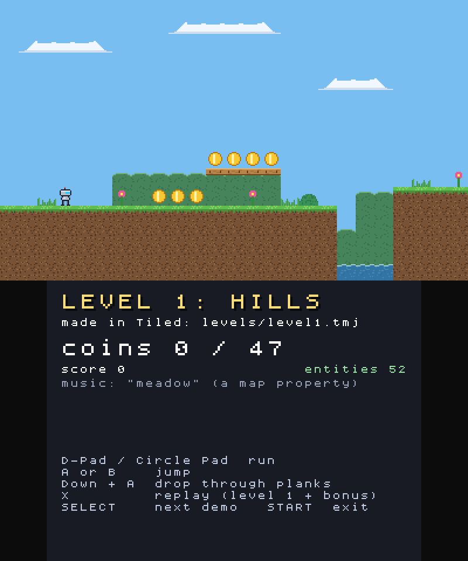
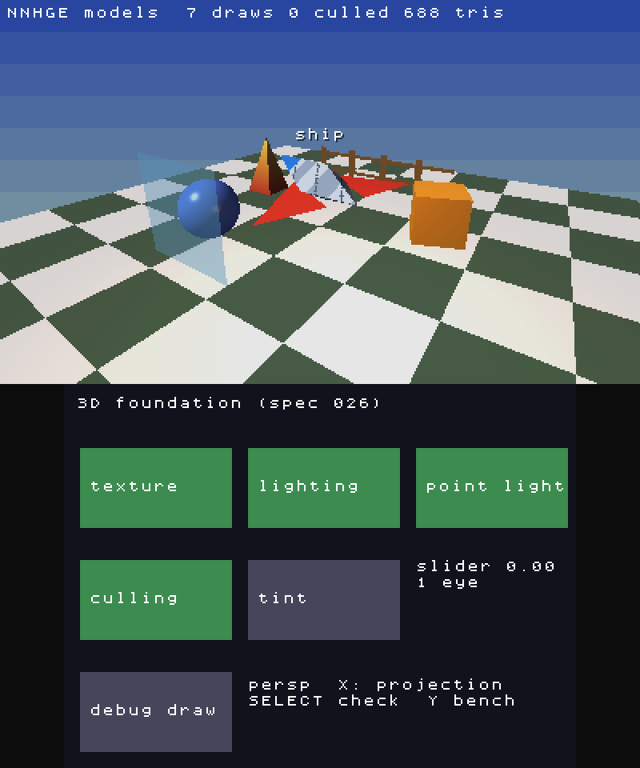
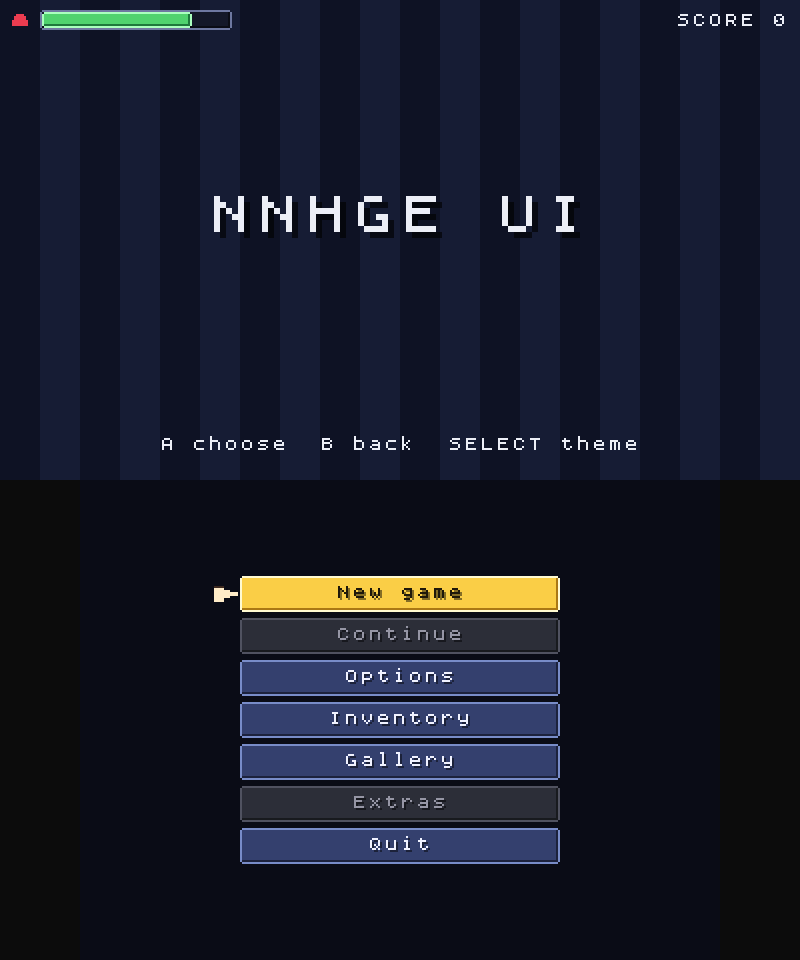
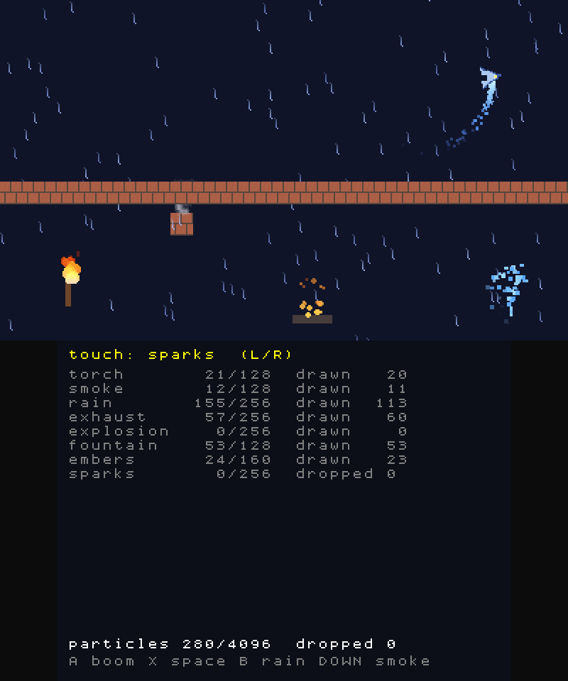

# NNHGE — Native Nimble Homebrew Game Engine

**A small, fast C++ engine for making homebrew games that run natively on the Nintendo 3DS — with a desktop
simulator, so you write, run and test the same game on your PC.**

NNHGE compiles your game to ARM machine code for the console (`.3dsx` for the Homebrew Launcher, `.cia` for the
HOME Menu), with no interpreter or virtual machine in between. The same source builds as a desktop app that shows
both screens, takes keyboard, mouse and gamepad input, runs at 60 Hz and keeps to the console's limits.

<p align="center">
  
  
  
  
</p>
<p align="center"><sub>Screenshots from the simulator: the examples <code>platformer</code>, <code>models</code>,
<code>ui</code> and <code>particles</code>. Every one of them also runs on a 3DS.</sub></p>

> **Status: approaching 1.0.** Everything listed below works on the simulator and on an Old 3DS, and is checked by
> unit tests, Linux builds and scripted runs on the console. Before 1.0: game fonts and localization, live values in
> the simulator, hot reload of assets, then a `nnh new` / `nnh doctor` CLI to start a project in a few commands.
> See the [roadmap](docs/ROADMAP.md).

## A taste

```cpp
#include <utility>

#include <nnh/app.hpp>
#include <nnh/gfx.hpp>
#include <nnh/input.hpp>
#include <nnh/scene.hpp>
#include <nnh/texture.hpp>

class Level final : public nnh::Scene {
public:
    void on_enter() override {
        if (auto hero = nnh::load_texture("art/hero")) hero_ = std::move(hero.value()); // assets/art/hero.png
    }
    void update() override {
        const nnh::Stick pad = nnh::input::circle_pad();
        pos_.x += pad.x * 2.0f;
        pos_.y -= pad.y * 2.0f; // stick y grows up, screen y grows down
        if (nnh::input::pressed(nnh::Button::Start)) nnh::scenes::pop(); // empty stack: the game ends
    }
    void draw() override {
        nnh::gfx::draw(nnh::Screen::Top, hero_, pos_);
        nnh::gfx::draw_text(nnh::Screen::Bottom, {8, 8}, "Circle Pad: move   START: quit");
    }

private:
    nnh::Texture hero_;
    nnh::Vec2 pos_{184, 104};
};

int main() {
    if (!nnh::init({.title = "My Game"})) return 1;
    Level level;
    nnh::run(level); // 60 frames a second, on the 3DS and in the simulator
    nnh::shutdown();
}
```

Game modes are **scenes** on a stack; moments (a button press, a coin collected, a sound finished) arrive as
**events**, and continuous state is a **query** (`held`, `circle_pad`). No platform `#ifdef` in game code: the
same file builds for the PC and the 3DS.

## What's inside

**Core**
- Game loop at a fixed 60 Hz, [scenes](docs/api/scene.md) with push/pop/replace, a typed [event bus](docs/api/events.md)
- [Input](docs/api/input.md): buttons, Circle Pad, touch, and the New 3DS's C-Stick and ZL/ZR (not yet tried on
  a New 3DS: help welcome); [input actions](docs/api/actions.md) with rebinding and contexts
- [Logging, asserts, results, memory tags, files, saves](docs/architecture/foundation.md), a debug overlay and a
  profiler
- [Tweens and timers](docs/api/tween.md) with 19 easings, the same bits on every system

**2D and 3D**
- [Sprites, shapes, layers and cameras](docs/api/gfx.md), [text](docs/api/text.md) with a built-in font,
  [camera helpers](docs/api/camera.md) (dead zone, limits, shake, zoom)
- [Sprite animation](docs/api/animation.md) from Aseprite, [particles](docs/api/particles.md),
  [scene transitions](docs/api/transition.md) (fades, wipes, irises, across both screens)
- [Tilemaps](docs/api/tilemap.md) built in code or drawn in [Tiled](docs/guides/levels.md): 4 full layers + 300
  sprites at 60 Hz on an Old 3DS
- [3D](docs/api/gfx3d.md): meshes from glTF, lighting, blending, culling, and the 3DS's **stereoscopic 3D**
- [UI widgets](docs/api/ui.md): buttons, sliders, lists of 10 000 items, dialogs, focus by D-Pad and touch, themes

**Gameplay**
- [Collision](docs/api/collision.md) without tunnelling, layers and masks, raycasts and shape queries
- [Pathfinding](docs/api/pathfinding.md): A* with weights and agent sizes, distance fields, path following
- [Entities, tags and pools](docs/api/entities.md), [prefabs](docs/api/prefabs.md) placed from Tiled,
  [a scene tree with transforms](docs/api/hierarchy.md)
- [Audio](docs/api/audio.md): WAV/Ogg sounds with volume, pan and pitch; streamed music with loop points and
  crossfades

**Data**
- [Assets](docs/api/assets.md) packed into romfs, converted and **checked at build time** (a typo in a level or a
  data file is a build error with `file:line: reason`)
- [Typed data assets](docs/api/data.md) in a small TOML-like format, read into your own structs
- [Versioned saves](docs/api/saves.md): old save files upgrade step by step, a backup on damage, the same bytes on
  PC and 3DS

**Tools**
- [`nnh`](docs/guides/nnh-tool.md): `nnh run <game>` builds, finds the console on the network, sends the game and
  shows its coloured log; `nnh install` sends a `.cia`
- [Test scripts](docs/guides/testing-on-the-console.md): press buttons, touch, take screenshots and check the log —
  the same script in the simulator and on a real 3DS, with a pass/fail exit code
- [NNH Link](docs/guides/nnh-link.md): a console app that asks your PC to build a game, then runs it
- [Packaging](docs/guides/packaging.md): `.3dsx` and `.cia` with your icon and banner

## Built to be predictable

- **The same result everywhere.** Layout, physics, pathfinding, particles and 3D math use the same arithmetic on
  the PC and the 3DS, so a replay or a checksum recorded on the PC matches the console bit for bit.
- **Measured on the real console.** Features with a cost per frame have a benchmark that runs on an Old 3DS and a
  budget they must stay within; the numbers are in their API pages.
- **No surprises in the frame.** No exceptions, no RTTI, no heap allocation per frame in the engine; you only pay
  for what you link (a game without 3D or UI carries no 3D or UI code).
- **Fast builds.** Editing a game file rebuilds the simulator in under 2 s and the `.3dsx` in under 5 s.
- **Tested.** About 3 600 unit tests, fuzzing, sanitizers and 32-bit builds on Linux, and scripted console runs
  before every feature is merged.

## Getting started

You need a C++20 compiler with CMake and Ninja, and [devkitPro](https://devkitpro.org/) for the 3DS. On Windows:

```sh
cmake --preset pc-debug && cmake --build --preset pc-debug      # the simulator, examples and the nnh tool
build/pc-debug/examples/platformer/platformer.exe               # play an example on the PC

scripts/dkp.sh cmake --preset 3ds-release                       # the 3DS build (once)
scripts/dkp.sh cmake --build --preset 3ds-release               # → build/3ds-release/examples/**/*.3dsx

build/pc-debug/tools/nnh/nnh run platformer                     # Homebrew Launcher → Y on the console first
```

The full setup (Windows; steps for Linux and macOS too, less tried), running on a console and making your own
game:
[docs/guides/getting-started.md](docs/guides/getting-started.md). The [examples](examples/) folder has one small
program per feature.

Running on a 3DS needs a console with custom firmware and the Homebrew Launcher. The `.3dsx` also opens in the
[Azahar](https://azahar-emu.org/) emulator.

## Documentation

| | |
|---|---|
| Guides | [getting started](docs/guides/getting-started.md), [the nnh tool](docs/guides/nnh-tool.md), [testing on the console](docs/guides/testing-on-the-console.md), [debugging on the 3DS](docs/guides/debugging-on-3ds.md), [NNH Link](docs/guides/nnh-link.md), [levels in Tiled](docs/guides/levels.md), [menus](docs/guides/menus.md), [3D models](docs/guides/models.md), [distributing your game](docs/guides/packaging.md) |
| API reference | [docs/api/](docs/api/) — one page per header, with costs and limits |
| Architecture | [docs/architecture/](docs/architecture/) — event bus and scenes, patterns, structure, every design decision and why |
| Technology | [docs/tech/](docs/tech/) — devkitPro and the 3DS, CMake, the C++ subset, SDL 3 |
| Roadmap and specs | [docs/ROADMAP.md](docs/ROADMAP.md), [specs/](specs/) — every feature starts as a spec |

The same pages are on the [project wiki](https://github.com/rafarvns/nnhge/wiki).

## Contributing

NNHGE is built spec first: a feature starts as a spec in [specs/](specs/), gets a plan checked against the
[constitution](docs/process/constitution.md), and is implemented test first. See
[CONTRIBUTING.md](CONTRIBUTING.md) and [docs/process/](docs/process/). The prior art we learn from is in
[docs/REFERENCES.md](docs/REFERENCES.md).

Using Claude Code? The repository ships project skills and agents (`.claude/`) that follow these rules.

## License

[zlib](LICENSE): use it for anything, including commercial games; credit is appreciated but not required.
NNHGE uses only the open homebrew toolchain (devkitPro) and contains no Nintendo SDK code; the art in the examples
is original.

NNHGE is an independent project, not affiliated with or endorsed by Nintendo. Nintendo 3DS is a trademark of
Nintendo; it is named here only to say which consoles the engine runs on.
