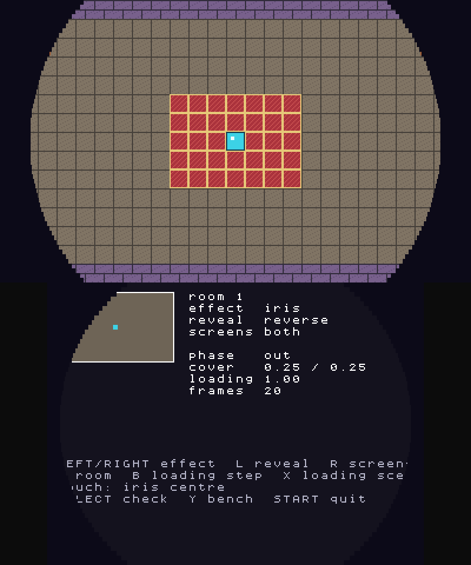
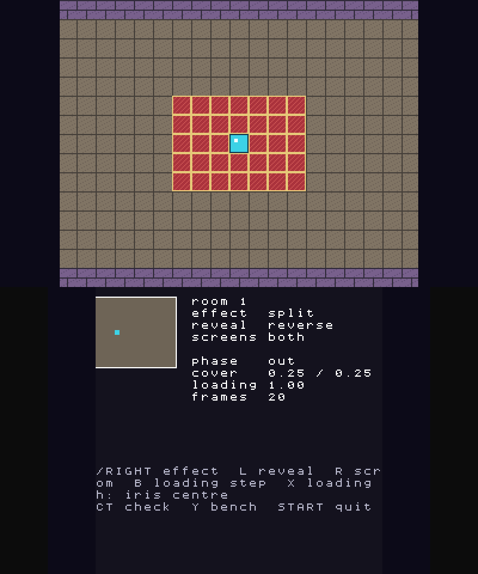
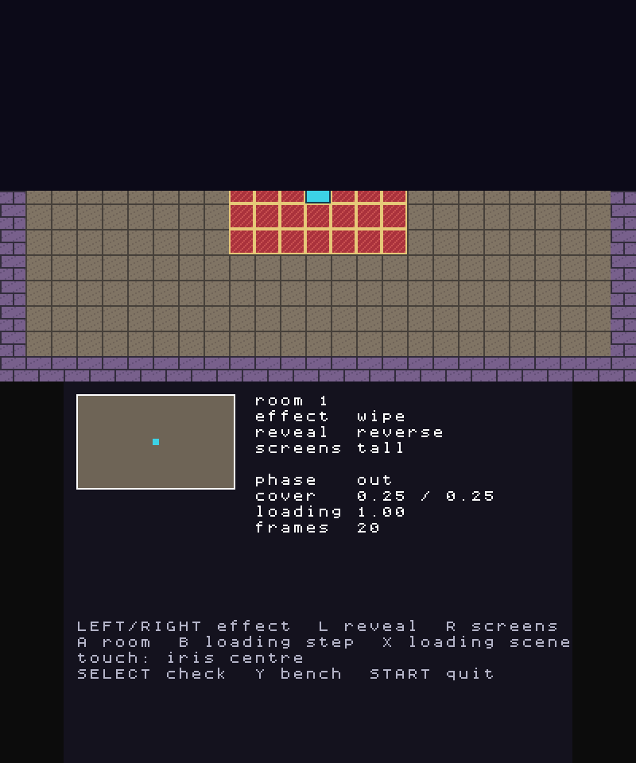
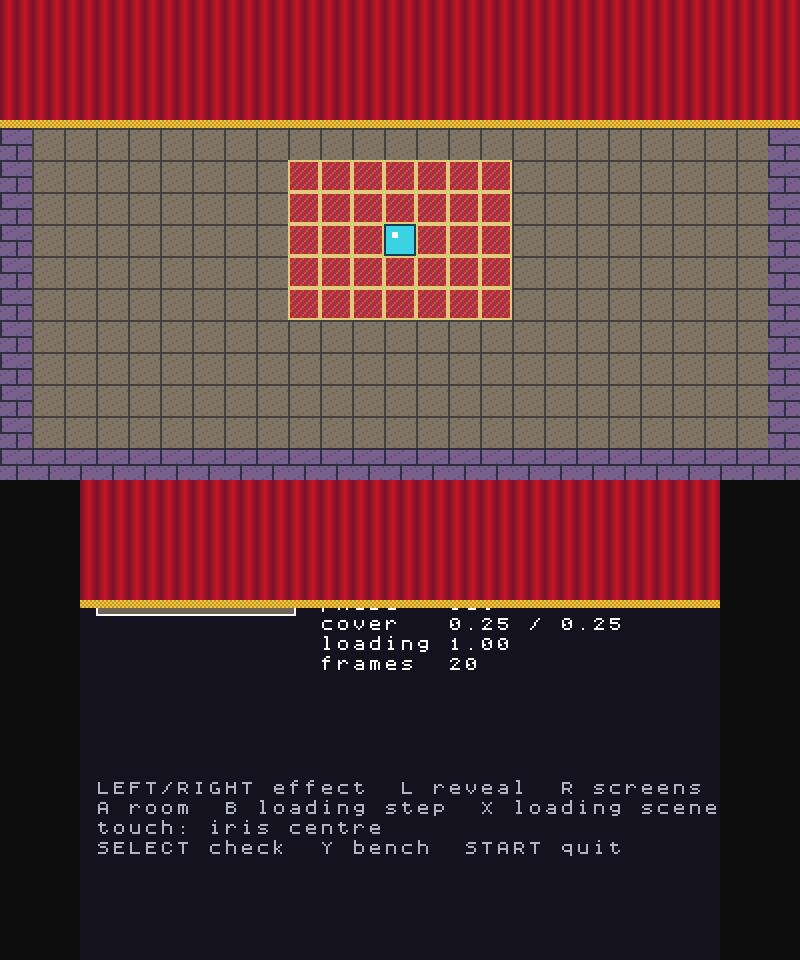

# transition — scene transitions: fades, wipes, splits, blinds, irises, loading

Header: `<nnh/transition.hpp>` · Spec: [023](../../specs/023-scene-transitions/spec.md) ·
Plan: [023](../../specs/023-scene-transitions/plan.md) · Decision: D38 ([decisions.md](../architecture/decisions.md)) ·
Example: [`examples/transitions`](../../examples/transitions/main.cpp) · In a game:
[`examples/platformer`](../../examples/platformer/demos.cpp) (its doors)

A transition is a scene change that **covers the screen, changes the stack exactly when the screen is fully covered,
optionally loads in slices while covered, then reveals the new scene** — in one call, on the frame clock, with game
input blocked meanwhile. Built-in effects are a fade, wipes, a split, blinds and an iris (circle or diamond), on one or
both screens or across both as one tall area; a game can draw its own effect. The same calls give the same frames and
pixels on PC and 3DS. `nnh::scenes::replace` stays instant: a game that never asks for a transition links none of
this.

```cpp
#include <nnh/transition.hpp>
namespace tr = nnh::transition;

// Title → level: fade to black and back (24 + 24 frames, the defaults).
tr::replace(level_);

// A door: an iris closing on the player over both screens, reopening on the new spawn point.
tr::replace(next_room_, {.effect = tr::iris(player_screen_pos), .tall = true,
                         .out = nnh::Frames{36}, .hold = nnh::Frames{6}, .in = nnh::Frames{36}});
// ...and in next_room_.on_enter():  if (tr::running()) tr::reveal_at(spawn_screen_pos);
```

## Requests and phases

| Call | Stack change (when the cover is full) |
|------|---------------------------------------|
| `replace(scene, options)` | replace the top scene |
| `push(scene, options)` | push `scene` |
| `pop(options)` | pop the top scene *of that moment* (nothing if the game emptied the stack: an error log) |
| `cover(options)` | none — `on_covered` is where the room changes |

Each returns `false` and changes nothing while another transition runs (one debug log per running transition: a door
entered twice in one frame is normal). One transition runs at a time. A transition runs four phases:

1. **Out** — the cover grows from 0 to 1 over `out` frames (the outgoing scene drawn under it);
2. **Covered** — the stack change has been applied (spec 001's deferred path: the same `on_exit()`, D30 `AfterExit`,
   `on_enter()`); `on_covered`, then the loading step once per frame until done, for at least `hold` frames (≥ 1);
3. **In** — the cover shrinks from 1 to 0 over `in` frames;
4. **Done** — `on_finished`, then your finish event; the next frame is a normal one.

Any of `out`, `hold` and `in` may be 0; all three 0 is the stack change plus one covered frame.

## The frame clock

Durations are `FrameTime`s (a `Duration` or `nnh::Frames{n}`) rounded to **whole 60 Hz frames, half up**, 0..10 s each
(`Duration::from_ms(500)` is 30 frames). A transition advances exactly one frame per frame — never by wall time: a
slow `on_enter()` or a debugger stop delays it and skips nothing. The **first frame** is the first
`scenes::update_and_draw()` after the request: a request in `update()` starts next frame, one from an event handler
or `on_enter()` starts this frame.

Coverage on out frame k of O is `out_ease(k / O)`, exactly 1 at k = O; on in frame k of I it is `in_ease((I − k) / I)`,
exactly 0 at k = I — so with the same curve the reveal plays the cover backwards, frame for frame. Easings are
[tween.md](tween.md)'s libm-free curves (`<nnh/ease.hpp>`): the same bits everywhere. Curves that overshoot (Back,
Elastic, Bounce) are clamped to 0..1 and **ratcheted** (coverage never goes back within a phase): they show
plateaus instead of overshoot.

## Effects

Every built-in effect is a function of the coverage c of a screen: nothing at 0, the whole screen opaque at 1, and the
covered area only grows during out and only shrinks during in. The colour's own alpha is ignored (covers are opaque);
a fade's alpha is round(c × 255).

| Maker | What it draws | Rectangles per screen |
|-------|---------------|-----------------------|
| `fade(color)` | the whole screen, alpha = coverage (a white fade is a flash) | 1 |
| `wipe(edge, color)` | an opaque rectangle growing from `Edge::Left/Right/Top/Bottom` | 1 |
| `split(axis, color)` | two rectangles closing to the middle (`LeftRight`: doors; `TopBottom`) | 2 |
| `blinds(edge, bars, color)` | `bars` (2..32, default 8) bars, each growing from its own edge | `bars` |
| `iris(center, shape, color, band)` | everything outside a `Circle` or `Diamond`, drawn as bands of `band` (1..16, default 4) rows | 2 × ⌈240 / band⌉ + 2 (122 at band 4; 124 in the tall area; 482 at band 1) |
| `custom()` | your `Options::custom` | yours |
| `none()` | this screen is never covered | 0 |






(`TRANSITIONS_SHOT=<iris|split|tall|curtain> NNH_EXIT_AFTER_FRAMES=40`, from `examples/transitions`.)

The iris starts fully open wherever its centre is (its radius at 0 reaches the farthest corner) and closes to a point;
its edge is a staircase of `band` pixels. The centre is an `IrisCenter`: `{point}` a top-screen point,
`{point, nnh::Screen::Bottom}` a bottom-screen one, `{}` the middle. Without `tall` each screen's iris uses the point in
its own coordinates.

Geometry is computed in integers from a 16.16 coverage `q = ⌊c · 65536 + ½⌋`: `ext(L) = (q · L + 32768) >> 16` pixels
of a length L; a split's halves are ⌈e/2⌉ (left/top) and ⌊e/2⌋; blind i spans [⌊i·L/N⌋, ⌊(i+1)·L/N⌋); the iris
samples each band at its middle row with an exact integer square root. Overlay draws count against
`AppConfig::gfx.max_draws` like any draw.

### Reveal styles

`reveal_style = Reveal::Reverse` (default) plays the out effect backwards (a wipe from the left recedes to the left, an
iris reopens on its point). `Reveal::Continue` keeps the cover travelling: wipes and blinds leave by the opposite edge,
a split opens from the middle (one centred band); a fade, an iris and a custom effect look the same either way.
`reveal = <effect>` gives the in phase its own effect or colour; `reveal_at(center)` replaces the in iris's centre
once the new scene is in (from `on_enter()` or `on_covered`; `false` once the in phase started).

### Screens and the tall area

One timeline drives both screens. Per screen and phase:

| Screen, phase | Effect |
|---------------|--------|
| top, out | `effect` (never `same()`) |
| top, in | `reveal`, else `effect` |
| bottom, out | `bottom`, else `effect` (`bottom = none()`: the bottom screen keeps its map) |
| bottom, in | `bottom_reveal`, else (`bottom` given ? `bottom` : the top's in effect) |

`tall = true` draws wipes, splits, blinds and the iris **once across both screens**, laid out as
[camera.md](camera.md)'s tall world: 400 × (480 + `tall_gap`) with the bottom screen at x 40..360 below the top one;
the gap (0..240) is drawn nowhere. A wipe from the top runs down the top screen and continues on the bottom one; an
iris on a bottom-screen point closes over both. Fades and custom effects stay per screen; `bottom`/`bottom_reveal`
must be `same()` with `tall`.

### Custom effects

`effect = custom()` (or any phase/screen) calls `Options::custom` — a function or a lambda with at most 16 bytes of
trivially copyable captures — once per frame for each screen whose effect is custom, **every transition frame**
(coverage 0 too), after the scenes' draws, with a `CustomFrame{screen, coverage, phase, frame, loading, tall}`. Draw
with the public `gfx` calls (`ignore_camera = true`, layer 15 keeps you above the scenes). Covering the screen at
coverage 1 is your job: a custom effect that doesn't cover shows the stack change. The example's curtain
([curtain.cpp](../../examples/transitions/curtain.cpp)) falls from the top in the example's own sprites and draws the
loading bar.

## Where the overlay draws

After every scene's `draw()` of the frame, with `gfx::fill_rect` on **layer 15, `ignore_camera`**: above everything the
scenes drew (their layer 15 included, same layer = call order), below the debug text and overlay, never zoomed. A
manual loop that draws after `scenes::update_and_draw()` draws over the transition (a HUD that stays visible).

## What the scenes do

| Phase | Stack | Draw | Update |
|-------|-------|------|--------|
| out | unchanged | every scene | none (`update_out = true`: the top scene keeps updating) |
| covered | changed | every scene, under the cover | none |
| in | changed | every scene | none (`update_in = true`: the new top scene updates) |

The incoming scene's first `update()` is the frame after the transition is done. D30 attachments (bound tween sets,
worlds, pools) are notified exactly when their scene's `update()` runs: a frozen scene's bound tweens freeze with it.
This is the one exception to spec 001's "the top scene updates every frame" ([scene.md](scene.md)).

## Input is blocked

By default (`block_input = true`) game input reads idle from the first transition frame until the frame after it is
done: no button held, sticks centred, no touch, no `ButtonPressed`/`Released`, touch or action events
([input.md](input.md#blocking-input), [actions.md](actions.md)). Remote input from `nnh run --script` is game input and
is blocked too; engine controls (SELECT + L, the simulator's keys) are not. When the block ends, every control held at
that moment stays blocked until released: the A that confirmed "Start" never makes the player jump. A game's own
`input::set_blocked()` is a separate blocker (one never lifts the other).

## Loading steps and loading scenes

`loading = [this] { return nnh::transition::LoadStep{progress, done}; }` is called once per covered frame, after the
stack change and `on_covered`, until it reports done; the covered phase lasts until then **and** `hold` frames (a hold
avoids a flicker when the load is instant). Progress is clamped to 0..1 (NaN → 0), shown by `loading_progress()` and
passed to the custom effect, so a loading bar can be drawn on the cover. The work runs inside the frame: you choose the
slice size; a slice longer than a frame only makes that frame long. A step still not done after 10 s logs one warning
in Debug/Development and keeps being called.

A **loading scene** needs no API: replace the room with it through a transition, let its `update()` work in slices
and show a tip and a bar, then start a second transition to the real scene from its `update()`
([title_scene.cpp](../../examples/transitions/title_scene.cpp)'s `LoadingScene`).

## Queries and notifications

| Query | Answer (inside a frame: scenes' update/draw, callbacks, custom effects) |
|-------|------------------------------------------------------------------------|
| `running()` | from the request to the end of its last frame (false in `on_finished`) |
| `phase()` | `None`, `Out`, `Covered`, `In` (the last in frame reports `In`, coverage 0) |
| `coverage(screen)` | this frame's, 0..1 (0 for a `none()` screen) |
| `phase_progress()` | out/in: k / n; covered: the hold's progress |
| `loading_progress()` | the step's last progress (1 without a step; 0 when no transition runs) |
| `frames()` | transition frames so far (1 on the first) |
| `timing()` | `{out, hold, in}` in frames, of the running (or last) transition |
| `seconds(frames)` | frames / 60 |

Between frames (after `update_and_draw()`), the queries already show the state the next frame starts in.
`on_covered` runs after the stack change, before the first loading step; `on_finished` in the last frame, before the
next scene update (it may start the next transition, which starts next frame); `publish = MyEvent{...}` queues a copy
of your event (≤ 32 bytes) when done. The engine publishes no event of its own. A cancelled transition (`shutdown()`,
the end of `run()`) calls nothing.

## Music

Transitions don't depend on audio. Fade the music with the picture yourself, with the transition's own durations
([audio.md](audio.md)):

```cpp
if (tr::replace(next_, options)) nnh::music::stop(tr::seconds(tr::timing().out));
// options.on_covered = [] { nnh::music::play("music/level", {.fade_in = tr::seconds(tr::timing().in)}); };
```

## Plain loops and interruptions

- `nnh::run()` and a manual loop calling `scenes::update_and_draw()` behave the same; a manual loop that may pop its
  last scene through a transition loops `while (nnh::frame() && (nnh::scenes::size() > 0 || tr::running()))`.
- A game without scenes can still use `cover()` (its per-frame step is `scenes::update_and_draw()`) or draw effects
  itself (below).
- Plain `scenes::push/pop/replace` during a transition apply as usual; the transition's own change applies to the stack
  of the moment the cover is full.
- A transition that pops the last scene runs its covered phase, then `run()` returns (the in phase is skipped).
- `nnh::shutdown()` and the end of `run()` cancel a running transition silently: no callback, no event, the waiting
  scene released, the input block lifted.

## Effects without a transition

```cpp
nnh::Rect rects[nnh::transition::kMaxEffectRects];
const int n = tr::effect_rects(nnh::Screen::Top, tr::blinds(), 0.5f, rects, std::size(rects)); // pure: no init
tr::draw_effect(nnh::Screen::Bottom, tr::fade(nnh::colors::white), flash_); // a pause flash, in a frame
```

`effect_rects` writes at most `capacity` rectangles (whole pixels, screen coordinates, drawing order) and returns how
many there are; `effect_color` the colour drawn; `max_rects(effect, tall)` the most per screen; `draw_effect` records
them (`Placement{.tall, .tall_gap, .continued, .layer}`). They are exactly what transitions draw. A game calling only
these links the geometry and none of the transition's frame code.

## Determinism

Phases, coverage bits, rectangles and the stack-change frames are the same on every host compiler and on the 3DS
(integer geometry, whole frames, spec 015's easings, `-ffp-contract=off`): the example's self-check checksums 1200
frames of them (`transitions: PASS BFE1D810`, recorded on the PC; the console's run is pending). The fade's blend is the GPU's: its colour may differ by one step per
channel between PC and 3DS; geometry never does.

## Costs

- State: 248 bytes on the 3DS (≤ 256), ≤ 320 on 64-bit PCs; nothing allocates, ever; no `virtual`; no log line in the
  normal path. The step and the overlay's recording are one profile scope, `transition`.
- Draws per frame: the table above, per screen (an iris at band 4: up to 244 for both screens).
- Games that never use transitions: the scene stack pays one null check per frame, the input path one load and branch;
  `hello` grew 88 bytes of 3DS text. Old 3DS timings: see [plan 023](../../specs/023-scene-transitions/plan.md)
  ("Stage 7 ARM pre-check"; the console run is pending). The example's bench (`TRANSITIONS_DEMO=bench`, Y) judges the
  Old 3DS targets in Development builds; on the PC its numbers include the SDL software renderer filling the overlay's
  pixels (≈ 0.3 ms per full-screen pair) and fail the console's targets: the console is the judge.

## Misuse

Asserts in Debug/Development; clamped or refused with an error log in Release, never undefined behaviour: durations
invalid (0) or over 10 s (600 frames); `effect = same()` or `custom()` without a callable (a fade); bars outside 2..32,
bands outside 1..16, `tall_gap` outside 0..240 (clamped); a NaN or infinite iris centre (the middle); `bottom` given with
`tall` (ignored); push/replace of a scene already on the stack, pop on an empty stack (refused). Destroying a scene that
waits in a transition, or pushing it elsewhere meanwhile, is caught like a pending push.
