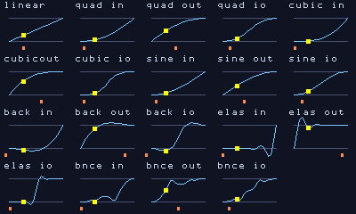

# tween — easings, tweens, sequences and timers

Header: `<nnh/tween.hpp>` · Spec: [015](../../specs/015-tweens-and-timers/spec.md) ·
Plan: [015](../../specs/015-tweens-and-timers/plan.md) · Example: [`examples/tweens`](../../examples/tweens/main.cpp)

Animate a `float`, a `Vec2` or a `Color` of your game from one value to another over a span of the frame clock,
with a standard easing, delays, loops, yoyo, sequences and parallel groups; run "after 1 s" and "every 2 s"
timers; be told when something finishes by a callback or by one of your own events. Everything advances by game
frames, so the same calls give the **same bits on PC and 3DS**. Nothing allocates while playing.

The module is optional: a game that doesn't include the header links none of it, and the easings and
`nnh::Timer` work alone, with no set, no scene and no `nnh::init()`.

```cpp
class Title final : public nnh::Scene {
    void on_enter() override {
        tweens_.sequence({.publish = IntroFinished{}})
            .from_to(&panel_y_, 250.0f, 70.0f, nnh::Duration::from_ms(500), {.ease = nnh::Ease::BackOut})
            .join().from_to(&tint_, nnh::rgb(20, 20, 40), nnh::rgb(30, 120, 140), nnh::Duration::from_ms(500))
            .wait(nnh::Duration::from_ms(200))
            .call([this] { ready_ = true; });
    }
    nnh::TweenSet tweens_{*this, {.tweens = 16, .steps = 8}}; // bound: updated and cleared by the scene
    float panel_y_ = 250;
    nnh::Color tint_{};
    bool ready_ = false;
};
```

## Easings



`Ease`, `ease()` and `Easing` live in the light header `<nnh/ease.hpp>` (only `<cstdint>`), which `<nnh/tween.hpp>`
includes: code that only needs the curves (scene transitions' `out_ease`/`in_ease`, [transition.md](transition.md))
includes it alone.

`nnh::ease(curve, t)` evaluates one of 19 curves (Robert Penner's equations) at progress `t`:
`Linear`, and `In`, `Out`, `InOut` of `Quad`, `Cubic`, `Sine`, `Back` (overshoot 1.70158), `Elastic` (period 0.3,
0.45 in-out) and `Bounce` — `nnh::Ease::BackOut`, `nnh::kEaseCount` = 19. It is a pure function: use it in your own
code too.

- Exactly 0 for `t ≤ 0`, NaN and `0 < t < 2⁻²⁴`; exactly 1 for `t ≥ 1`. `Back` and `Elastic` leave [0, 1] in
  between; the others stay inside it.
- **Same bits everywhere.** The curves never call the C math library: `sine` and `elastic` use the engine's own
  polynomial `sin` (error < 2·10⁻⁶) and `2^x` (relative error < 10⁻⁶), and the module is compiled without fused
  multiply-add. Every curve stays within 1/4096 of the exact equation; a golden table pins the bits of all 19
  curves at 33 points on every compiler.
- `nnh::Easing` takes a built-in curve or your own `float(float)` function wherever a curve is accepted
  (`.ease = my_curve`). Your own functions are your own float code, outside the determinism guarantee.

## The frame clock

Times are `nnh::FrameTime` values ([time.md](time.md#frames-and-frametime-the-frame-clock)): a `Duration` or
`nnh::Frames{n}`, in ticks of 1/4096 of a 60 Hz frame. Each update of a set is exactly one frame, never measured
wall time:

- a tween of 0.5 s takes exactly 30 updates, 1 s takes 60, `Frames{n}` takes n;
- leftover time carries into the next loop and the next sequence step: three 0.5 s steps end on update 90, ten
  loops of 1 s on update 600;
- `set_speed(0.5)` doubles every length exactly (speeds are rounded once to 1/4096; 0 freezes the set);
- `advance(time)` moves by any span (from `time::FixedStep`, to skip an intro), keeping the sub-tick remainder.

Times must be within 0..1 hour.

## Tween sets

A `nnh::TweenSet` owns tweens, timers and sequences. Its storage is one block reserved when it is created (memory
tag `tween`), sized by required capacities: `TweenSetConfig{.tweens = 1..1024, .steps = 0..4096}`. Nothing
allocates afterwards; a full set returns an empty handle (asserts in Debug/Development, logs in Release).

| Start | |
|-------|-|
| `to(&value, end, time, options)` | from the value it has when the tween **starts** (after its delay) to `end` |
| `by(&value, delta, time, options)` | from the value at the start to start + `delta` |
| `from_to(&value, from, end, time, options)` | given start; with no delay, `from` is written at once |
| `from_to(nnh::Setter<T>{fn}, from, end, time, options)` | calls `fn(value)` instead of writing a pointer |
| `after(time, fn)` · `after(time, Event{})` | a timer: calls `fn` or publishes your event once |
| `every(period, fn, times = kForever)` | calls `fn` at the end of every period (several in one update if they end) |
| `sequence(options)` | a sequence builder, below |

`TweenOptions` (designated initializers): `.ease`, `.delay`, `.loops` (n or `nnh::kForever`), `.loop_mode`
(`Restart` or `Yoyo`: backwards with the mirrored curve, each direction one loop), `.on_finish`, `.on_loop`,
`.publish`.

**Targets.** A pointer target must outlive its tween: keep the set and the values in the same object (a scene).
For values that may disappear first (a pooled enemy), use a setter that looks the object up by id and does
nothing if it is gone. `Vec2` interpolates each component; `Color` each channel, clamped to 0–255 and rounded, so
`Back`/`Elastic` never wrap a colour. When a tween ends it writes its end value exactly (the start value for an
even number of yoyo loops).

**Handles.** Starting returns a `nnh::TweenHandle` (slot, set, generation). `running`, `paused`, `progress` (of the
current loop), `loops_left`; `pause`, `resume`, `kill` (stops where it is, no callback), `complete` (jumps to the
end of the last loop, then runs its completion). A handle whose tween ended is **stale**: queries answer "not
running", commands do nothing. A handle of another set asserts.

**Group commands.** `pause_all`, `resume_all`, `kill_all`, `kill_target(&value)` (every tween on that address, and
whole sequences that animate it). Two tweens on one value both write, in start order: the later one wins.

## Completion: callbacks or your events

- `on_finish` runs inside the update in which the tween ends, after its final value is written; `on_loop` at the
  end of every loop but the last.
- `.publish = IntroFinished{}` queues a copy of **your** event (trivially copyable, at most 32 bytes) when it
  ends; it is delivered at the next dispatch like any event ([events.md](events.md)). The engine publishes no
  event of its own.
- `kill`, `kill_all`, clearing a set and destroying it run no callback and publish nothing.
- Callbacks are stored inline: a function or a lambda with at most 16 bytes of captures (`[this]`, `[this, id]`).

**Re-entrancy.** Callbacks may start, pause, complete or kill tweens of the same set, themselves included. A tween
started during an update counts from the next update (a `from` is still written at once); a tween killed during an
update is not updated or called again; completing a tween from its own callback does nothing more. A chain of
callbacks completing tweens stops calling back at depth 8 (`kMaxCallbackDepth`), with one logged error. Updating
or destroying a set from its own callback asserts (Release: destruction is deferred safely).

## Sequences

```cpp
nnh::TweenHandle h = tweens.sequence({.loops = 2, .loop_mode = nnh::LoopMode::Yoyo})
                         .to(&x, 100.0f, nnh::Frames{20})
                         .join().to(&alpha, 0.0f, nnh::Frames{12}) // plays with the previous step
                         .wait(nnh::Frames{9})
                         .call([this] { sparkle(); });            // each time the sequence passes here
```

- Steps play one after another; `join()` makes the next step play together with the previous one (a group lasts
  as long as its longest member). Steps take the same targets and options as tweens (finite loops only) and
  capture their start values when the sequence reaches them; `from` values of the first group are written at once.
- The sequence's handle works like a tween's; its options add a delay, loops, yoyo (the steps play backwards in
  reverse order), `on_finish`, `on_loop` and `.publish`. `complete` jumps every step to its end; `kill_target` on a
  step's value kills the whole sequence.
- Call steps run in both directions; a step's own `on_finish`/event run when it ends in forward play.
- Each step uses one tween slot and one step record (`TweenSetConfig::steps`); at most 64 steps per sequence and 1
  hour in all. Append every step before the sequence starts; a step that can't be added removes the whole sequence
  (empty handle, asserts in Debug/Development).

## Timers

Two styles: `after`/`every` in a set (callback style, with handles), or the plain value `nnh::Timer` (query style,
12 bytes, no set):

```cpp
nnh::Timer shot_ = nnh::Timer::repeating(nnh::Duration::from_ms(250));
void update() {
    for (int n = shot_.update(); n > 0; --n) fire(); // how many periods ended this frame
}
```

`Timer::once(time)`, `Timer::repeating(period)`; `update()` (one frame) or `advance(time)`; `running`, `paused`,
`elapsed`, `remaining`, `progress`; `pause`, `resume`, `stop` (halts and rewinds), `restart`.

## Scene-bound sets

`nnh::TweenSet tweens_{*this, {.tweens = 32}};` as a member of a scene binds the set to it
([architecture/scenes.md](../architecture/scenes.md#scene-attachments-d30)):

- it is updated automatically right before the scene's `update()`, **only while the scene is on top**: a pause
  menu pushed over a level freezes the level's animations while its own bound set keeps playing;
- it is cleared silently (no callbacks, no events) right after the scene's `on_exit()` — on `pop`, `replace`, the
  end of `run()` and `shutdown()` — so nothing writes into the scene or calls back into it once it has left; start
  tweens again in `on_enter()`;
- don't call `update()`/`advance()` on it (asserts); `bound()` tells.

An **unbound** set (`nnh::TweenSet set{{.tweens = 32}};`) is updated by your code once per frame: in a plain loop
without scenes, in a HUD object that lives across scenes, in a transition layer. The engine keeps no global set.
Destroy sets before `nnh::shutdown()` (a set alive after it shows in the leak report).

## Animating UI widgets

The UI never includes this header: tween a widget through a setter on `Ui::set_render_offset` or `Ui::set_opacity`,
which move and fade it when drawn without a relayout ([ui.md](ui.md), [menus guide](../guides/menus.md#animating-with-tweens)).

## Costs and limits

| | 3DS | PC (x64) |
|-|-----|----------|
| one tween slot (hot + cold) | 184 B | 224 B |
| one sequence step record | 8 B | 8 B |
| set header | 68 B | 96 B |
| `TweenSet` object · `nnh::Timer` | 4 B · 12 B | 8 B · 12 B |
| 256 active tweens, `update()` | console run pending | 0.06 ms average, 0.23 ms worst (pc-debug) |

Per active tween and update: one list step, integer time arithmetic, one divide, one curve (elastic is the
dearest) and 1–4 interpolations. A scene with nothing bound pays one pointer and a null check per frame. Limits:
1024 tweens and 4096 steps per set, 64 steps per sequence, 1 hour per time, callback captures 16 B, finish events
32 B, callback depth 8.

**Determinism notes.** The 3DS and an x86-64 PC both round floats to nearest (libctru sets the FPU so); the 3DS
flushes subnormals to zero, the PC doesn't. The curves never produce subnormals, but values you tween to
magnitudes below 2⁻¹²⁶ are not guaranteed bit-identical. Your own easing functions and setters are your code.

## Example

[`examples/tweens`](../../examples/tweens/main.cpp): the easing gallery (top) and an intro sequence with a timer
and an `nnh::Timer` blink (bottom); A pause, B complete, Y restart, X pushes an overlay scene with its own bound
set (the showcase freezes under it); SELECT goes to a self-check (600 frames of tweens, sequences, loops and timers
with a checksum the console must match) and to a 256-tween bench.

```sh
NNH_EXIT_AFTER_FRAMES=150 NNH_SCREENSHOT=build/tweens.png build/pc-debug/examples/tweens/tweens.exe
TWEENS_DEMO=check NNH_EXIT_AFTER_FRAMES=605 build/pc-debug/examples/tweens/tweens.exe   # tweens: PASS ...
nnh run tweens --pc --script examples/tweens/tests/check.nnhs                          # the console script, on PC
```
